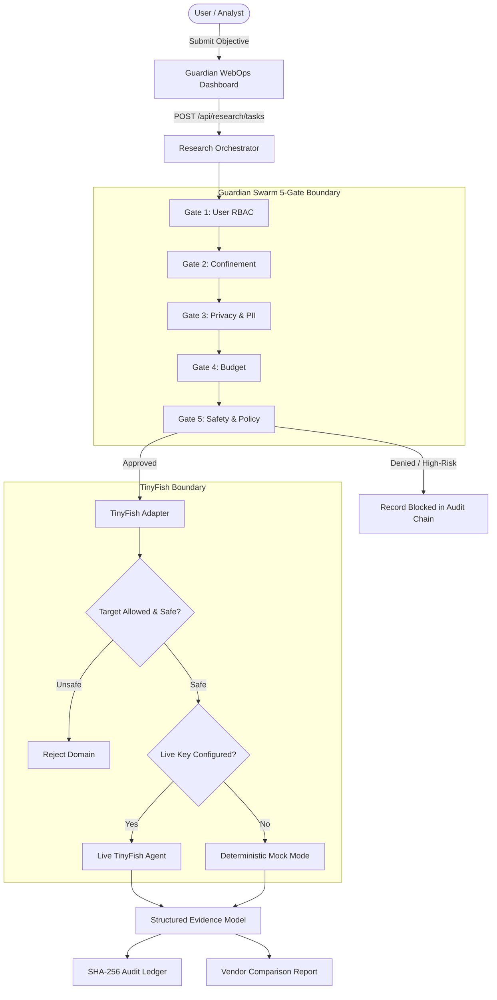

# Guardian WebOps

> **The trust layer for autonomous web research.**

Governed web-research application combining **TinyFish**-powered public-web intelligence with **Guardian Swarm V3**'s existing zero-trust governance framework.

[](https://www.python.org/)
[](LICENSE)
[]()

---

## 1. Product Identity

- **Product Name:** Guardian WebOps
- **Tagline:** The trust layer for autonomous web research.
- **Description:** Governed web research with policy-controlled workflows, source-linked evidence, and auditable decisions.
- **Team:** CODE FREAKS
- **Core Principle:** TinyFish researches the web. Guardian Swarm governs the controlled workflow. Guardian WebOps presents the evidence and decisions.

---

## 2. Core Features

1. **Autonomous Research Workspace:** Submit multi-vendor comparison tasks targeting public security, compliance, and privacy documentation.
2. **5-Gate Zero-Trust Governance Pipeline:**
   - **Gate 1: Access Control (RBAC):** Role authorization checks.
   - **Gate 2: Tool Confinement:** Restricts specialist agents to approved tools; blocks write or shell execution.
   - **Gate 3: Privacy & Data Classification:** Scans for PII and sensitive data before network dispatch.
   - **Gate 4: Budget Guardrails:** Pre-flight token and query bounds checking.
   - **Gate 5: Safety & Policy:** Intercepts high-risk targets and records outcomes to the ledger.
3. **Structured Evidence Model:** Explicit evidence statuses (`FOUND`, `MISSING`, `CONFLICTING`, `UNVERIFIED`, `FAILED_TO_RETRIEVE`) with direct source URLs and excerpts.
4. **Transparent Execution State:** Live TinyFish execution vs. simulated mock execution is clearly labeled in the UI (`[SIMULATED]`).
5. **Cryptographic Audit Trail:** SHA-256 tamper-evident hash-chained ledger verifying every decision.

---

## 3. Architecture Overview



---

## 4. Technology Stack

- **Backend:** Python 3.9+, Flask, SQLAlchemy, Pydantic, Cryptography (Fernet & SHA-256)
- **Frontend:** Vanilla HTML5, CSS3 (Light theme), JavaScript (ES6+ modular fetch API)
- **Web Research:** TinyFish SDK / API with safe deterministic mock fallback
- **Testing:** Pytest (Unit, Integration, Security, and Governance test suites)

---

## 5. Prerequisites & Quickstart

### Prerequisites
- Python 3.9 or higher
- Git

### Installation

```bash
# Clone the repository
git clone https://github.com/Purusothamansuba/vendor-hub.git
cd vendor-hub

# Create virtual environment
python -m venv .venv
source .venv/bin/activate  # On Windows: .venv\Scripts\activate

# Install dependencies
pip install -r requirements.txt
pip install -e .
```

### Environment Configuration

Copy `.env.example` to `.env`:

```bash
cp .env.example .env
```

To enable live TinyFish web research, configure your key:
```env
TINYFISH_API_KEY=sk-tinyfish-your-key-here
```
*(If left empty, Guardian WebOps operates safely in mock mode).*

### Launch the Application

```bash
python app.py
```
Open your browser to: [http://127.0.0.1:5000](http://127.0.0.1:5000)

---

## 6. Testing

Run the complete test suite:

```bash
python -m pytest
```

Execute only WebOps research workflow tests:
```bash
python -m pytest tests/test_webops_workflow.py
```

---

## 7. Project Structure

```
guardianwebops/
├── app.py                         # Application entrypoint
├── requirements.txt               # Dependencies
├── pyproject.toml                 # Package definition & pytest config
├── .env.example                   # Configuration template
├── config/                        # Settings & environment configuration
├── docs/                          # Architecture & integration documentation
│   ├── architecture.md
│   └── tinyfish-integration.md
├── guardian_swarm/
│   ├── core/
│   │   ├── evidence_models.py     # Structured research & evidence schemas
│   │   ├── research_service.py    # 5-gate research workflow orchestrator
│   │   ├── interceptor.py         # Gate evaluation interceptor
│   │   ├── user_rbac.py           # Gate 1: Role RBAC
│   │   ├── confinement.py         # Gate 2: Confinement
│   │   ├── privacy_gate.py        # Gate 3: Privacy & PII scanning
│   │   ├── budget_gate.py         # Gate 4: Budget guardrails
│   │   └── policies.py            # Gate 5: Tool & target safety policies
│   ├── integration/
│   │   └── tinyfish_adapter.py    # TinyFish client & mock engine
│   ├── utils/
│   │   ├── audit.py               # Cryptographic SHA-256 audit ledger
│   │   ├── database.py            # SQLite ORM & models
│   │   └── paths.py               # Project workspace paths
│   └── web/
│       ├── server.py              # Flask HTTP & REST API endpoints
│       ├── static/                # CSS styling and dashboard JS
│       └── templates/             # index.html
└── tests/                         # 95 passing pytest suites
```

---

## 8. License

This project is licensed under the MIT License.