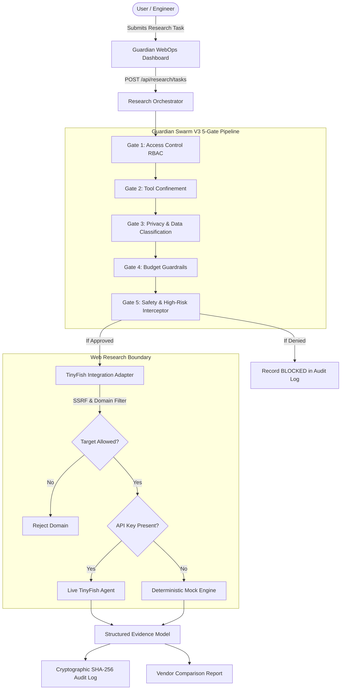

# Guardian WebOps Architecture

## Product Statement
**Guardian WebOps** is the trust layer for autonomous web research. It merges TinyFish-powered public-web intelligence with Guardian Swarm's five-gate governance framework.

## Core Modules
- `guardian_swarm/integration/tinyfish_adapter.py`: Isolates TinyFish API from application business logic; performs SSRF filtering and provides honest simulated fallback.
- `guardian_swarm/core/evidence_models.py`: Pydantic models for `ResearchTask`, `VendorResearchResult`, and `ResearchClaim` with explicit `EvidenceStatus` values (`FOUND`, `MISSING`, `CONFLICTING`, `UNVERIFIED`, `FAILED_TO_RETRIEVE`).
- `guardian_swarm/core/research_service.py`: Orchestrates task execution through the 5-gate pipeline before web retrieval.
- `guardian_swarm/core/interceptor.py`: Enforces RBAC, Confinement, Privacy, Budget, and Safety rules.
- `guardian_swarm/utils/audit.py`: Cryptographically chained SHA-256 block ledger.
